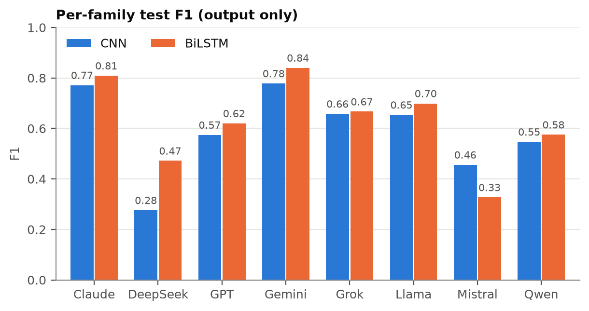
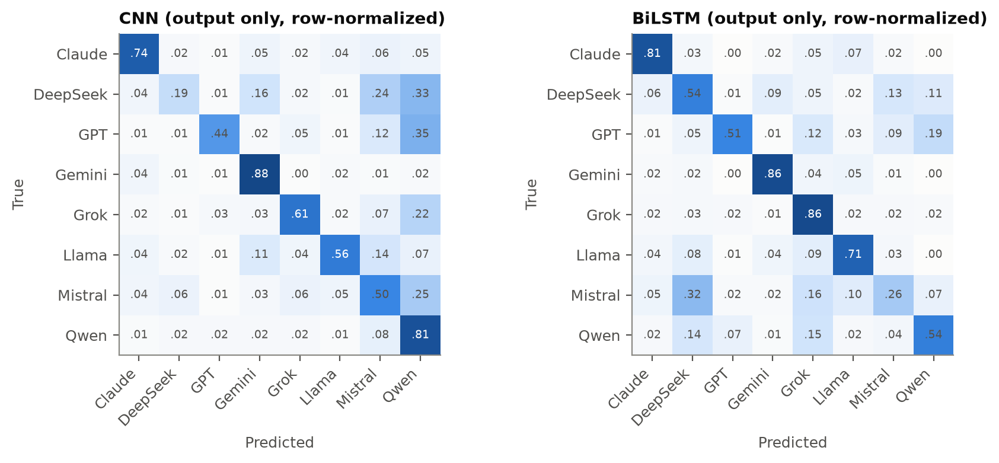
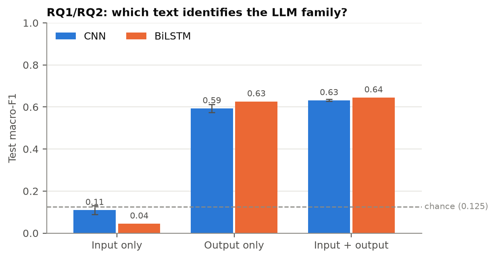
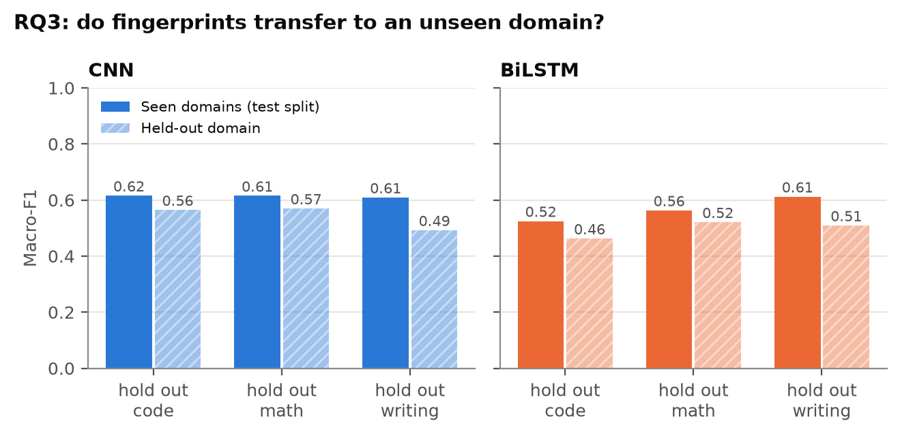
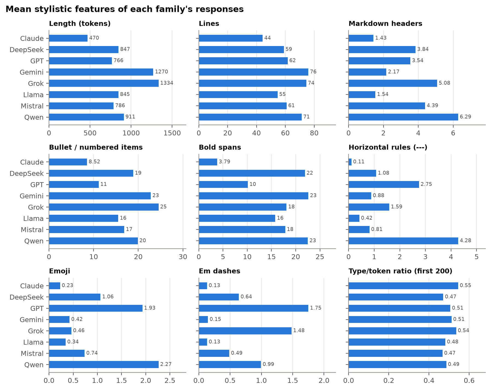
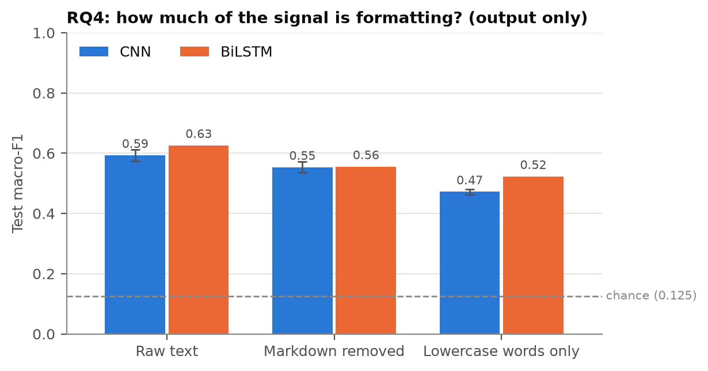
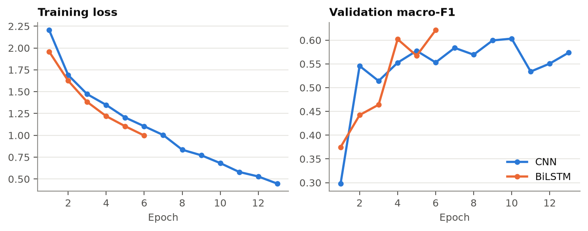

**Code and results:** <https://github.com/Gameslayer999/cmpsc448-midterm>

# 1. Problem definition and dataset

## 1.1 Problem

Given a response written by a large language model, can we tell which model family wrote it? We
frame this as 8-way text classification over the families **Claude, DeepSeek, GPT, Gemini, Grok,
Llama, Mistral and Qwen**, and study four questions:

- **RQ1:** classify the family from the response (`LLM_output`) alone, with a CNN and an RNN.
- **RQ2:** compare *input only*, *output only* and *input + output*.
- **RQ3 (extra):** does a classifier trained on some task domains work on an unseen domain?
- **RQ4 (extra):** which characteristics distinguish the families, and how much does removing them hurt?

The main metric is **macro-F1** on a held-out test set (accuracy is also reported). With 8
balanced classes, chance is 0.125.

## 1.2 Data source

We use the public **LMArena `arena-human-preference-140k`** dataset (Hugging Face,
`lmarena-ai/arena-human-preference-140k`, 7 parquet shards). Each record is one "battle" from the
Chatbot Arena: a real user's prompt was sent to **two anonymous models picked by the platform**, and
both responses were recorded together with the model names. Conversations date from
**April 17 to July 24, 2025**. Each side of a battle gives one `(LLM_name, LLM_input, LLM_output)`
triple. No API calls or private data were used.

## 1.3 Curation (`src/prepare_data.py`)

1. **Filtering.** Keep English, single-turn conversations whose prompt and response are both
   text only (anything with an image is dropped) and non-empty.
2. **Family labels.** Map each model name to a family by prefix (e.g. `claude-*`→Claude,
   `gpt-*`/`chatgpt-*`/`o3*`/`o4*`→GPT, `qwen*`/`qwq*`→Qwen). Models outside these eight product
   lines (Gemma, Nova, Command, MiniMax, Kimi, Hunyuan) are dropped, so each class is one product line. The final
   classes contain 2–8 model versions each (Table 1), so the task is to recognize a *vendor's
   family style*, not one checkpoint.
3. **Balancing.** Sample exactly **4,000 responses per family** (32,000 total, seed 448).
4. **Splitting.** Split 80/10/10 **by battle id**, so a prompt and its two responses always land in
   the same split. Otherwise the two responses to one prompt could fall in train and test, and an
   input-based classifier could memorize the prompt.
5. **Domain tags (for RQ3).** From the dataset's own category tags: `code` if the battle is
   flagged as code, else `math`, else `writing` (creative writing), else `general`.

| Family | Models (top versions) | Train | Val | Test |
|---|---|---:|---:|---:|
| Claude | Opus 4, Sonnet 4, 3.7 Sonnet (+thinking) … (8) | 3193 | 364 | 443 |
| DeepSeek | R1-0528, V3-0324 (2) | 3236 | 390 | 374 |
| GPT | o3, chatgpt-4o-latest, o4-mini, o3-mini … (8) | 3242 | 383 | 375 |
| Gemini | 2.5 Flash, 2.5 Pro, 2.0 Flash … (8) | 3173 | 406 | 421 |
| Grok | Grok 3 preview, 3 mini, Grok 4 (4) | 3182 | 444 | 374 |
| Llama | Llama 4 Maverick / Scout, Llama 3.3 70B (4) | 3232 | 373 | 395 |
| Mistral | Medium 2505, Small 3.1/2506, Magistral (4) | 3195 | 400 | 405 |
| Qwen | Qwen3-235B (±thinking), Qwen3-30B, QwQ-32B (6) | 3170 | 401 | 429 |
| **Total** | 44 model versions | **25,623** | **3,161** | **3,216** |

: Table 1. Dataset composition. Domains over all 32,000 rows: general 17,268, code 10,381,
writing 2,483, math 1,868.

The split is by battle, so per-split family counts differ slightly from 400/3,200/400; the classes
remain close to balanced in every split.

# 2. Models and training

## 2.1 Text representation (`src/text.py`)

Text is tokenized with the regex `\w+|\n|[^\w\s]`, which **keeps case, punctuation, markdown
symbols (`#`, `*`, `|`, `` ` ``), emoji and newlines as tokens**. We did this deliberately,
because formatting is plausibly part of a model's fingerprint and lowercasing or dropping
punctuation would throw that away before the model sees it. The vocabulary holds the 30,000 most
frequent tokens with count ≥ 2, **built from the training split only**; everything else maps to
`<unk>`. Sequences are truncated to **512 output tokens** and **256 input tokens**. For input + output,
the input is cut to 128 tokens and joined to the output with a `<sep>` token.

## 2.2 CNN (`TextCNN` in `src/models.py`)

A Kim-style text CNN: 128-dim learned embeddings → three parallel 1-D convolutions of width 3, 4
and 5 (128 filters each, ReLU) → **max-pooling over time with padding masked out** → dropout 0.5 →
linear layer to 8 classes. Each filter acts as a detector for one short n-gram-like pattern
(e.g. `"\n * **"` or `"Okay ,"`), and max-pooling asks "did this pattern appear anywhere?".
**4.04M parameters**, 3.84M of them in the embedding.

## 2.3 RNN (`BiLSTM` in `src/models.py`)

128-dim embeddings → one-layer **bidirectional LSTM** (128 hidden units per direction), run on
packed sequences so padding is never processed → the hidden states are summarized by **both
mean- and max-pooling** over time (512 features) → dropout 0.5 → linear to 8 classes. Mean-pooling
captures overall style, while max-pooling catches distinctive local events. **4.11M parameters.**

## 2.4 Training (`src/train.py`, `src/run_all.py`)

| Setting | CNN | BiLSTM |
|---|---|---|
| Loss / optimizer | cross-entropy / Adam, lr 1e-3 | same |
| Batch size | 64 (length-bucketed) | 64 (length-bucketed) |
| Gradient clipping | norm 5 | norm 5 |
| Max epochs / early stopping | 20 / patience 3 on val macro-F1 | **6** / patience 2 |
| Seeds | **3** (0, 1, 2) | 1 (0) |
| Time per run (Apple M-series GPU, MPS) | ~4 min | ~45 min |

: Table 2. Training configuration.

After training, the weights from the epoch with the best **validation** macro-F1 are restored and
evaluated **once** on the test split. Batches group examples of similar length, which mostly
benefits the LSTM by avoiding wasted computation on padding.

**Why the two models are trained differently.** On the MPS backend one BiLSTM epoch took
about 460 s, against about 23 s for the CNN (≈ 20× slower; on CPU it was slower still). Training
all 13 LSTM configurations with 3 seeds and 20 epochs was not feasible before the deadline, so
the LSTM got one seed and a 6-epoch cap. **Every LSTM run except input-only reached that cap**, and the main run's
validation curve was still rising (Figure 7), so the LSTM numbers below are a *lower bound* on what it can do.

**Non-neural reference.** As a sanity check we also train TF-IDF (word uni+bigrams, same tokenizer,
sublinear tf) + logistic regression on the same splits (`src/baseline.py`).

# 3. Results

All numbers are test-set macro-F1. CNN results are the mean ± standard deviation over 3 seeds;
LSTM results are a single run.

## 3.1 RQ1: identifying the LLM from its response

| Model | Accuracy | Macro-F1 |
|---|---:|---:|
| Chance | 0.125 | 0.125 |
| CNN | 0.611 | 0.593 ± 0.018 |
| BiLSTM | **0.638** | **0.626** |
| *TF-IDF + logistic regression (reference)* | *0.754* | *0.747* |

: Table 3. RQ1, output only.

**Yes: both networks identify the family well above chance**, with about 5× chance macro-F1. The
BiLSTM is slightly better than the CNN despite having seen at most 6 epochs. The linear TF-IDF
model is clearly better than both (discussed in §4.4).

{width=80%}

{width=95%}

Recognizability varies a lot by family. **Gemini (F1 0.78 / 0.84) and Claude (0.77 / 0.81)** are the
easiest for both models, while **DeepSeek and Mistral are the hardest** (CNN 0.28 and 0.46; LSTM 0.47
and 0.33). The errors are not random. Under the CNN, DeepSeek, GPT, Grok and Mistral are often
predicted as **Qwen** (33%, 35%, 22%, 25% of their rows), and DeepSeek is also confused with
**Mistral** (24%). The LSTM moves those errors around rather than removing them: it predicts
Mistral responses as DeepSeek 32% of the time. Those three families (DeepSeek, Mistral, Qwen) are
the most similar in the feature analysis below: all use many headers, bullets and bold text, and
all are among the least lexically diverse.

## 3.2 RQ2: does the prompt help?

| Input to the classifier | CNN | BiLSTM | TF-IDF + LR |
|---|---:|---:|---:|
| Input only | 0.110 ± 0.021 | 0.045 | 0.130 |
| Output only | 0.593 ± 0.018 | 0.626 | 0.747 |
| Input + output | **0.632 ± 0.005** | **0.645** | 0.724 |

: Table 4. RQ2, test macro-F1.

{width=75%}

**(i) Can the LLM be predicted from the prompt alone? No.** All three classifiers are at chance on
input only. The BiLSTM's 0.045 means it collapsed to predicting nearly one class, which is the
best a model can do when the input carries no signal. This follows from how the data was
collected: **the Arena assigns models to a prompt at random, and each prompt is answered by two
different families**, so the prompt is statistically independent of the label. Splitting by
battle makes sure the models cannot cheat by memorizing a prompt seen in training.

**(ii) Does adding the input help? A little, for the neural models.** Input + output improves the
CNN by +0.039 (larger than its seed standard deviation) and the LSTM by +0.019. Since the input
alone is useless, the gain must come from *interaction*: the prompt tells the model what a
"normal" response looks like (a request for code makes code blocks expected; "hi" makes a long
markdown answer surprising), so the response's style can be judged relative to the request. The
TF-IDF model, which just adds input features to output features and cannot model interactions,
gets slightly *worse* (0.747 → 0.724) from the extra noise features.

**(iii) When could input-only work surprisingly well?** It would in a dataset where *who answers*
depends on *what is asked*, for example responses collected from each model with different
prompt sets, a coding-only model, or when the user writes "as Claude, …". Then an input-only
classifier is learning the **collection process, not the model**. Our near-chance input-only
result is evidence that this dataset is free of that leak.

## 3.3 RQ3: generalization across domains

For each domain *d* ∈ {code, math, writing}, we train on all *other* domains (using their
train/val splits) and evaluate on (a) the test split of the seen domains and (b) **every row of
the held-out domain** (10,381 code, 1,868 math, 2,483 writing).

| Held-out domain | CNN seen | CNN held-out | Δ | LSTM seen | LSTM held-out | Δ |
|---|---:|---:|---:|---:|---:|---:|
| code | 0.615 | 0.564 | −0.05 | 0.525 | 0.463 | −0.06 |
| math | 0.615 | 0.570 | −0.05 | 0.563 | 0.521 | −0.04 |
| writing | 0.609 | **0.492** | **−0.12** | 0.612 | 0.509 | −0.10 |

: Table 5. RQ3, macro-F1 (one seed per configuration).

{width=85%}

**(i) Performance does drop on unseen tasks, but it does not collapse.** Every held-out score stays
at 3.7–4.6× chance. Writing transfers worst for both models (−0.10 to −0.12). Creative writing is
the domain where models drop their usual assistant formatting (headers, bullets, "Here's…"), so
the formatting cues learned on other domains are less available. Code is the largest domain
(about a third of the data), so removing it shrinks the training set the most, which likely also explains
the LSTM's lower seen-domain score in that setting.

**(ii) Some families are much more stable than others.** Per-family F1 for the CNN on the held-out
domain: **Gemini (0.84 / 0.73 / 0.63 on code / math / writing) and Claude (0.65 / 0.76 / 0.69)**
remain identifiable everywhere, while **Mistral (0.28 / 0.30 / 0.23)** and **DeepSeek
(0.41 / 0.32 / 0.41)** are weak everywhere. Qwen drops sharply on writing (0.31).

**(iii) General fingerprint or task-specific patterns? Mostly general, with a task-specific part.**
If the classifier had learned only task-specific patterns, scores on a domain it has never seen
would fall toward chance; instead most of the in-domain performance survives. The 5–12 point gap
is the task-specific part.

## 3.4 RQ4: what distinguishes the families?

We answer this three ways: descriptive statistics, **ablations** that remove a class of signal
before training, and the most predictive features of the linear model.

**Descriptive statistics** (`src/features.py`; per-response means):

{width=100%}

- **Length:** Claude is by far the most concise (median 269 tokens), while Grok (1,195) and
  Gemini (1,005) write 4× more. Length alone separates Claude from everyone else.
- **Markdown structure:** Claude uses the least markdown (1.4 headers, 3.8 bold spans per
  response). Gemini, Qwen and DeepSeek use the most bold text (~22), and Qwen the most headers (6.3)
  and horizontal rules (4.3).
- **Typographic habits:** GPT uses the most em dashes (1.75 per response) and, with Qwen, the most
  emoji (1.9–2.3). Claude, Gemini and Llama almost never use em dashes (~0.13).
- **Lexical diversity** (type/token ratio of the first 200 tokens) is highest for Claude (0.55)
  and Grok (0.54) and lowest for Mistral, DeepSeek and Llama (~0.47–0.48).

**Ablations** retrain each model on transformed outputs:
`no_markdown` removes headers, bullets, numbering, bold, code fences and rules, and collapses all
whitespace (so no line structure is left). `words_only` additionally lowercases and keeps only
alphanumeric words, dropping punctuation, emoji and capitalization.

| Text seen by the model | CNN | BiLSTM |
|---|---:|---:|
| Raw text | 0.593 ± 0.018 | 0.626 |
| Markdown + whitespace removed | 0.554 ± 0.019 (−0.04) | 0.556 (−0.07) |
| Lowercase words only | 0.472 ± 0.008 (−0.12) | 0.523 (−0.10) |

: Table 6. RQ4 ablations, output only, test macro-F1.

{width=75%}

**Most predictive n-grams** (highest-weight TF-IDF features per class, `results/baseline.json`):

| Family | Examples of the strongest features |
|---|---|
| Claude | plain `-` bullets, `\n \n` paragraph breaks, "would", "through" |
| DeepSeek | `/`, `&`, `—`, "Key", ending with "Would you …" |
| GPT | curly quotes `’ “ ”`, `•` bullets, `—`, "Summary", "! Here" |
| Gemini | opening with "Okay ," / "Of course", `* **` bullet + bold, tables `| :` |
| Grok | "Below is", ", such as", "If you", "more details" |
| Llama | `\n +` bullets, "# Step", "Now ,", numbered steps |
| Mistral | "Would you like", `# *` header styling, "? Let" |
| Qwen | `✅`, `---` rules, LaTeX `$`, "Final" |

: Table 7. Top TF-IDF + LR features.

**(i) What signals do the classifiers use?** Both kinds. Formatting (markdown, line structure),
**typography** (curly vs straight quotes, `•` vs `-` vs `*` bullets, em dashes, emoji) and **stock
phrases** at the start and end of a response ("Okay,", "Of course", "Below is",
"Would you like…") are the strongest cues.
**(ii) Linguistic, structural or both? Both, and the linguistic part is larger.** Removing all
markdown and line structure costs only 0.04–0.07; removing punctuation, case and emoji as well
costs 0.10–0.12 in total. But **even reduced to lowercase words, both models remain at ~4×
chance (0.47–0.52)**, so a large share of the fingerprint lives in word choice and phrasing.
**(iii) Does removing signals hurt substantially?** Moderately: the drops are real (well beyond
seed noise for the CNN) but far from destroying the classifier. This is consistent with RQ3: the drop when transferring
to writing (0.10–0.12), a domain with less assistant-style formatting, is the same size as the
drop from removing all formatting, punctuation and case (words-only, 0.10–0.12).

# 4. In-depth analysis

## 4.1 CNN vs LSTM

The two networks finish within 0.03 of each other on every setting, but the details differ. The
LSTM is **more robust to removing surface cues** (words-only: 0.523 vs 0.472), consistent with its
ability to model longer-range word patterns rather than detecting local n-grams. The CNN is
**~10× cheaper to train** and its 3-seed spread (σ ≈ 0.02) lets us say which differences are real.
The learning curves (Figure 7) show the CNN overfitting quickly (training loss keeps falling while
validation F1 plateaus by epoch ~7–10 and fluctuates by ±0.03 between epochs), while the LSTM was
still improving when it was stopped.

{width=90%}

## 4.2 Why some families are confusable

DeepSeek, Mistral and Qwen share a heavily formatted "headers + bold + bullets" style and
low lexical diversity, and that is exactly where most errors go. Several families also contain
**reasoning and non-reasoning variants** (DeepSeek R1 vs V3, Qwen3 with and without thinking,
o3 vs chatgpt-4o), whose final answers can look more like *each other across vendors* than like
their own siblings. Claude and Gemini, the easiest classes, have the most distinctive surface style
(very concise vs. very long, "Okay," openers and heavy `* **` bullets).

## 4.3 Seed variance

Across 3 seeds the CNN's macro-F1 varies by σ = 0.005–0.021. Differences smaller than about 0.03
(e.g. CNN vs LSTM on output only) should therefore not be over-interpreted. The LSTM and RQ3
numbers come from one seed and carry at least that much uncertainty.

## 4.4 Why a linear model beats both networks

TF-IDF + logistic regression (0.747) beats the CNN by 0.15 and the LSTM by 0.12. We think three
factors explain most of the gap:

1. **It sees the whole response.** The networks truncate at 512 tokens, while the median
   response of five of the eight families exceeds 700 tokens. Length and formatting cues spread across a long
   response are partly invisible to the networks.
2. **The signal is mostly "which tokens occur", which is exactly what TF-IDF measures.** The RQ4
   analysis shows that individual tokens and phrases (`’`, `•`, `✅`, "Okay ,") carry much of the
   signal. Word order matters less, which is the CNN/LSTM's main advantage.
3. **Data size.** With 25k training examples, the 4M-parameter networks overfit quickly (Figure
   7), while the regularized linear model with fixed features does not.

This doesn't make the neural models pointless. They show the same patterns in every RQ, and the
ablations would be equally informative with the baseline. But it is the most important caveat
about the absolute numbers.

## 4.5 Limitations

- The LSTM was trained with one seed and was still improving when capped at 6 epochs.
- Truncation at 512 tokens hides part of long responses.
- RQ3 uses one seed per held-out domain, and the domain tags come from the dataset's automatic
  classifier.
- Families mix model versions released over several months; results describe this
  April–July 2025 snapshot of each vendor, not a timeless fingerprint.
- Identical prompts (e.g. "hi") can recur in different battles and therefore in different splits;
  this cannot leak the label (prompts are independent of the family) but slightly weakens the
  "unseen prompt" guarantee.

# 5. Lessons learned

*[Draft prepared from the project log; to be revised in my own words.]*

1. **Check how the data was collected before trusting a result.** The RQ2 input-only result is only
   interpretable because the Arena assigns models at random. With a different collection process,
   a high input-only score would have measured the dataset, not the models. Splitting by battle,
   rather than by row, was needed for the same reason.
2. **Always train a simple baseline.** We added TF-IDF + logistic regression as an afterthought,
   and it beat both neural models by a wide margin. Without it, the report would have presented
   0.6 macro-F1 as "good" without context.
3. **Design long experiments to survive interruptions.** The computer crashed midway through the
   first session, and later the experiment sweep died on run 14 of 26. Because each run writes its
   own result file and the runner skips finished runs, recovering meant re-running one command and
   losing at most one run.
4. **Hardware choices shape the experiments.** On Apple's MPS backend the LSTM was ~20× slower
   than the CNN, which forced fewer seeds and epochs for it, and therefore weaker conclusions about
   the RNN. MPS also crashed on a 1-token batch (a case CPU handles fine); the fix was to pad every
   batch to at least the widest convolution.
5. **Watch whether training is cut off by an arbitrary cap.** An early 10-epoch cap was stopping
   the CNN while validation F1 was still rising. Raising the cap and letting early stopping decide
   was a one-line change, but it would have silently biased every CNN result.
6. **Ablations answer "why" better than accuracy does.** Removing markdown and punctuation and
   retraining gave a direct, quantitative answer to which signals matter, which descriptive
   statistics alone could not.

# Appendix: reproducing the results

```
python src/prepare_data.py          # data/raw/*.parquet -> data/dataset.parquet
python src/run_all.py               # 26 CNN/LSTM runs -> results/runs/*.json (resumable)
python src/baseline.py              # TF-IDF + LR -> results/baseline.json
python src/features.py              # RQ4 statistics -> results/features.csv, figures/features.png
python src/analyze.py               # tables -> results/summary.md, figures/*.png
```
